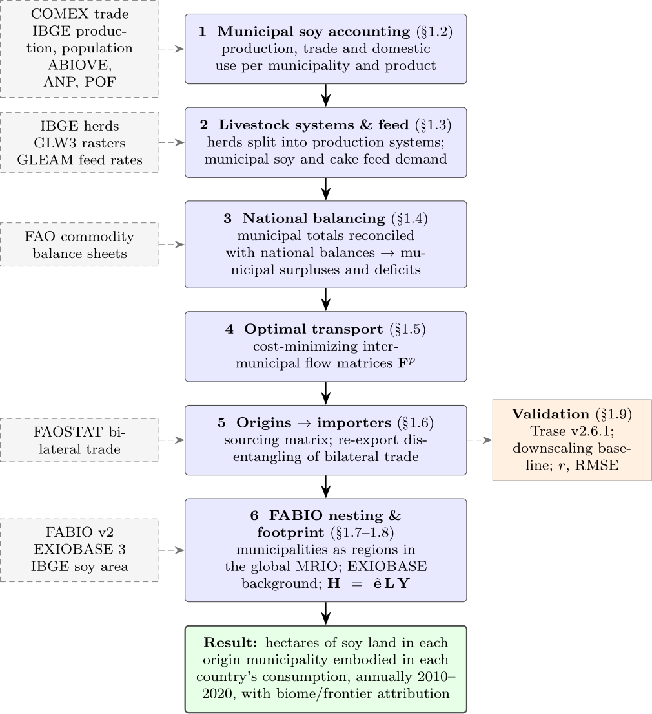

 
 
# Mapping the land-use footprint of Brazilian soy embodied in international consumption: A spatially explicit input-output approach

### 🌐 [**Explore the interactive footprint map →**](https://lizaburiak.github.io/soyprint-footprint-map/)

### 📄 Paper drafts (render in-browser): [**Data section**](https://lizaburiak.github.io/land-use-footprint-brazilian-soy/paper/data_section/data.pdf) · [**Methods section**](https://lizaburiak.github.io/land-use-footprint-brazilian-soy/paper/methods_section/methods.pdf)

### 💾 [**Download the results database →**](https://doi.org/10.5281/zenodo.23057008)
The release (version 1.0.0, build commit `e35c056`, years 2000–2022) is deposited at Zenodo, DOI [10.5281/zenodo.23057008](https://doi.org/10.5281/zenodo.23057008): `soyprint.sqlite` (15 tables with keys and indexes), the same tables as Parquet (`soyprint_parquet.zip`), and `data_dictionary.csv` documenting every table and field. This is the fastest way to use the results without running the pipeline.

### Note for people interested in reproducing results:
The model requires a wide range of input data for all modelling steps. All data is publicly and freely available, but cannot directly be provided here for download due to different copyright licenses. Instead, see [`DATA.md`](DATA.md) for the full manifest — where every dataset comes from and where it must be placed — plus the `code/download_data.py` script that programmatically fetches the auto-downloadable inputs straight into the pipeline's input tree. 

----

> **Repository layout:** see [`STRUCTURE.md`](STRUCTURE.md) for the folder map — the
> year-parameterized model (`code/pipeline/`), its paper figures (`code/analysis/`) and
> prep feeders (`code/prep/`), and the purpose-organized `data/` (raw/geo/fabio/trase/exiobase).
>
> **Running it:** each year runs in its own worker directory (`code/setup_worker.sh`,
> `code/run_core.sh`, `code/run_fp.sh`), for 2000–2022. See [`RUNBOOK.md`](RUNBOOK.md) for the
> steps, the software versions and how the release was built.

----

### Code structure:

 - Code files are numbered in chronological order:
   - 0-5 build the subnational data foundation
   - 7 models subnational transport flows (straight-line/Euclidean distances)
   - 8-11 connect flows to importing countries, assess model sensitivity and benchmark the "origin-to-importer" flows against trase and a pure downscaling
   - 12-19 nest the subnational supply chain flows into FABIO, adapting the existing [FABIO](https://github.com/fineprint-global/fabio) and [FABIO hybrid](https://github.com/fineprint-global/fabio-hybrid) code
   - 20-21 compute land-use footprints on the municipal level and refine them to the grid level (30m) using [MapBiomas](https://mapbiomas.org/) data. The soy land-use tiles are downloaded from Google Erath Engine, using an [adapted version](https://code.earthengine.google.com/969e903c53a0bf85db4f1e804a5c3b32) of the official MapBiomas [user toolkit](https://github.com/mapbiomas-brazil/user-toolkit).

----

### Model scheme

Stages 1–5 reconstruct Brazil's subnational soy supply chain; stage 6 embeds it in the global FABIO/EXIOBASE input–output framework and computes the land-use footprint.
